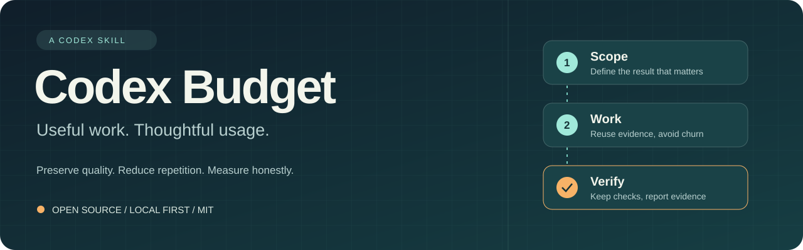

# Codex Budget

**Complete useful work while conserving Codex subscription allowance.**

[Русский](README.md) · [Test report](docs/test-report.md) · [Human guide, Russian](docs/guide.ru.md) · [MIT](LICENSE)

Version **0.3.0** · **28 local utility tests passed** · **Savings not yet proven**

Codex Budget is a small local skill that encourages focused investigation, reuse of relevant evidence, fewer repetitive attempts, and appropriate verification. It preserves your requested scope and quality. Settings advice and usage measurement happen when useful or requested.

It cannot increase your allowance, enforce a hard spending cap, or switch the current model through prompt text. No paid API client, telemetry, background monitoring, or automatic settings changes are included.

## Install and use

When `skill-installer` is available:

```text
$skill-installer install https://github.com/Skynetuz/codex-budget/tree/main/skills/codex-budget
```

Then:

```text
$codex-budget Fix this CSV import bug. Keep my current model,
stay within scope, and run the necessary checks.
```

```text
$codex-budget Recommend economical settings for routine website edits.
Do not change settings yet.
```

```text
$codex-budget Measure the observed allowance change for this task
if a supported usage tool is available.
```

For manual installation, copy only `skills/codex-budget` into the skill directory supported by your host. Environments using `$CODEX_HOME/skills` should use that location, commonly `~/.codex/skills`; current documentation also describes `~/.agents/skills` and project-local `.agents/skills`. See [Build skills](https://learn.chatgpt.com/docs/build-skills). Avoid duplicate copies in multiple scanned paths; restart Codex if discovery needs refreshing.

The instructions require no dependencies or API keys. The optional comparison utility requires Python 3.10+ and uses only the standard library.

## What changed in 0.3.0

- Reduced the entrypoint to fewer than 200 whitespace-delimited words, including metadata; this is not a measured quota reduction.
- Moved conditional settings and measurement guidance into the existing reference.
- Preserve full noisy logs locally while returning exit status, summaries, and diagnostic context.
- After two failed attempts at one hypothesis, change approach using evidence; do not automatically abandon the task or ask for permission to continue.
- Added a [three-task experiment design and rationale (Russian)](docs/experiment-v0.3.md). Agent trials have not been run. The existing helper measures quota deltas only; other metrics need separate records.

## Included since 0.2.0

- A local comparison utility with 28 automated tests.
- Explicit handling of used versus remaining quota.
- Active-turn readings labeled as checkpoints, not final charges.
- Public test reports permitted only when requested and sanitized.
- A detailed human guide, real observation report, and redesigned repository page.

## Evidence, not promises

The [test report](docs/test-report.md) separates automated utility tests from actual account-usage observations and a future controlled comparison. Passing software tests does not establish that the skill changes agent behavior or saves subscription allowance.

Usage readings may be rounded, delayed, or affected by concurrent work. Five-hour and weekly windows must be evaluated separately. A reading taken during an active turn excludes later work and final accounting. Model and effort reported by a user are labeled accordingly.

This release has no controlled baseline without the skill. It makes no measured savings claim.

## Reproduce utility tests

```text
python -m unittest discover -s tests -v
```

Compare normalized snapshots:

```text
python skills/codex-budget/scripts/compare_usage.py before.json after.json
```

See the [schema and methodology](skills/codex-budget/references/measurement.md). The utility reads only supplied files, writes no input files, makes no network calls, and emits no exact task-cost or savings estimate.

Tests cover ordinary changes, remaining percentages, resets, missing data, invalid values, timezone equivalence, CLI behavior, and omission of unrelated private fields from output. The test count is a static local result, not a CI status.

## Background and contributions

The project began with a discussion of [this KV-cache article](https://habr.com/ru/articles/978498/). Its instructions are independently written. [API cache discounts](https://developers.openai.com/api/docs/guides/prompt-caching) do not directly determine [subscription allowance](https://learn.chatgpt.com/docs/pricing).

Contribute anonymized examples and expected versus actual behavior. Savings claims need comparable tasks, settings, quality checks, and documented confounders. See [behavioral scenarios](docs/validation.md) and the [changelog](CHANGELOG.md).

## Authors

**[Skynetuz](https://github.com/Skynetuz)** — project creator: concept, requirements, direction, and feedback.

**Codex (OpenAI)** — AI co-author: skill and utility implementation, tests, documentation, banner, and repository presentation, created at Skynetuz's direction.

AI co-authorship describes the tool's contribution; it does not imply organizational participation or endorsement by OpenAI. An independent community project. MIT licensed.
